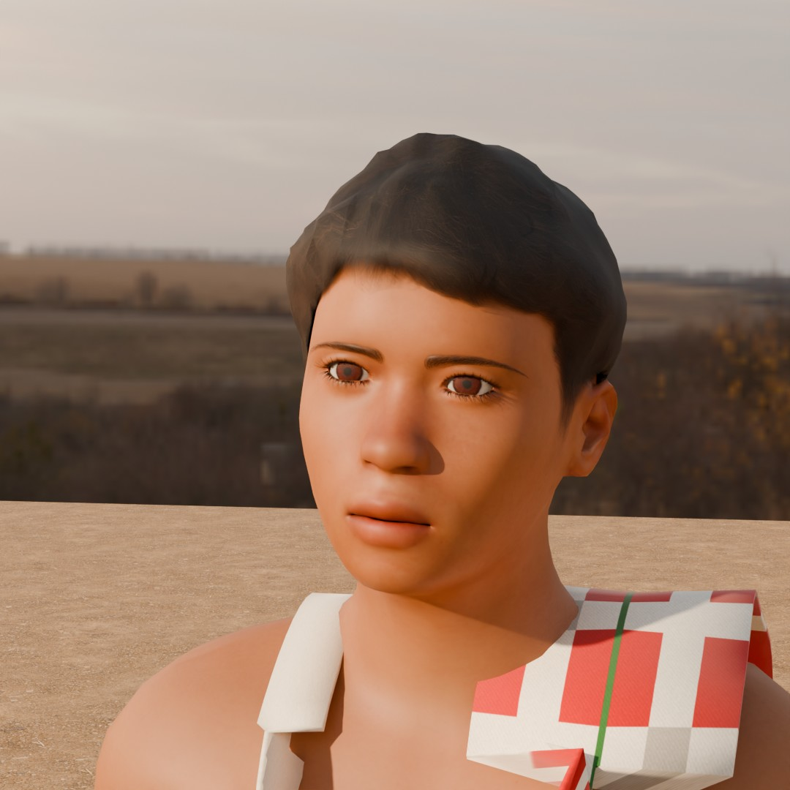

# Character mockups

## Bablu (বাবলু): free resources only

**Purpose:** see how close free tools get to the Real Cricket 24 benchmark (D17) before deciding on paid tools or an artist (D16).

### Version 3, 30 October 2026: his own face, without a real person's photo


| Front | Face |
|---|---|
|  |  |

What changed from version 2 (all still free, no real person's face used):

- **Face shape:** 27 MakeHuman face targets (CC0) set in the `FACE` table of the script: broader nose with fuller nostrils, fuller cheeks and cheekbones, heavier lower brow, rounder and wider jaw, slightly deeper-set eyes. The targets come from the packaged MPFB 2.0.18 release (Blender Extensions, SHA-256 `c075b3e9…2dad`), because the GitHub source leaves them out. Copy its `data/targets/` into the vendor MPFB source before building.
- **Skin colour detail, generated per vertex:** darker skin around the eyes and on the lips, a faint upper-lip shadow, warmer nose and cheeks, darker knees and elbows, lighter nails, a darker scalp under the hair, and low-frequency tone variation. A second attribute makes the nose and forehead slightly shinier in renders. The colour detail is also exported to the 3D model as vertex colours.
- **Eyes and brows:** darker brows, glossy wet-looking eyes.

### Version 2

| Three-quarter | Face |
|---|---|
|  |  |

- **Lungi:** simulated with Blender's cloth solver. The waist is pinned, spare fabric settles on the posed body and forms real folds, and the folded hem follows the settled edge.
- **Hair:** 1,600 hair cards grown from the MakeHuman hair cap, with a generated strand texture (soft roots, thin tips). The fringe is swept aside and kept above the eyes.
- **Skin:** a tiling pore normal map (also exported to the 3D model) and stronger subsurface scattering in the renders.
- **Gamcha:** wider and with more detail across, still shaped rather than simulated. A simulated version crumpled, and a thick towel keeps its drape anyway.

### Version 1 (first attempt)

| Three-quarter | Face |
|---|---|
|  |  |

### How it's made

`art-source/create_mockup_bablu.py`, run headless in Blender 4.5 LTS.

- Body, skin, eyes, brows, lashes and hair cap: MakeHuman CC0 assets through the MPFB2 v2.0.18 add-on. Age about 15, broad build, skin tinted toward #9C6440, black hair.
- Clothing generated from the body's evaluated shape and skinned to the same game rig: a lungi (blue check, waist roll, tuck knot, hem), a vest with shoulder straps, and a red-and-white checked gamcha.
- Light: Poly Haven "Evening Field" HDRI (CC0) plus a warm low sun; ground uses the project's village-earth texture.
- Renders: Cycles, 128 samples, AgX. The full build takes about 2 minutes plus rendering on a desktop CPU.

To rebuild: download the assets with `fetch_mockup_assets.py` (needs MPFB2 v2.0.18 in `art-source/vendor/mpfb/`, with the packaged release's `data/targets/` copied in, and the HDRI in `art-source/vendor/hdri/`), then run:

```bash
blender -b --factory-startup -P art-source/create_mockup_bablu.py -- --samples 128
```

The `.blend` file and the web 3D model (`.glb`) are written to `art-source/vendor/`.

### Assessment against the benchmark

| Area | Version 1 | Version 2 | Version 3 |
|---|---|---|---|
| Proportions, build, skin tone | Good | Good | Good |
| Rig (Unity, mocap) | Good | Good | Good |
| Light | Good | Good | Good |
| Lungi | Stiff tube | Real folds (simulated) | Same as v2 |
| Hair | Helmet-like cap | Strand cards; fine at game distance | Same as v2 |
| Face | MakeHuman default | Same face | **His own face** with believable colour variation |
| Skin up close | Smooth | Pores (subtle) | Still smooth: no fine wrinkles or pore-level colour |
| Vest, gamcha | Stiff | Shaped, no wrinkles | Same as v2 |

**Verdict on the free route:** it gives a believable game character at play distance, which is what the phone camera shows. Close-up realism at Real Cricket 24 level (faces in replays and celebrations) needs scanned or photographed skin detail: MetaHuman (free, Unreal), a paid character tool, or an artist. The renders are offline quality; the in-game real-time look is flatter.
